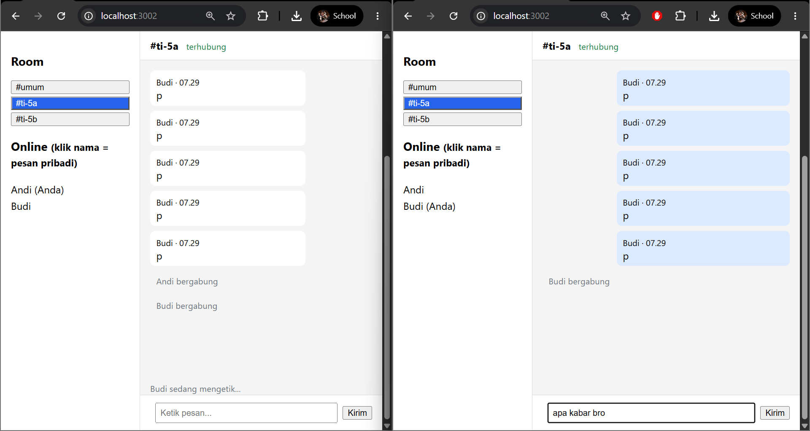

<div align="center">

# 📡 Laporan Praktikum Pertemuan 10: Real-time Communication (WebSockets)


**Mata Kuliah:** `IFT5251P` — Pemrograman Berbasis Kerangka Kerja  
**Program Studi:** S1 Teknik Informatika — STMIK Widya Cipta Dharma  
**Semester:** Ganjil 2026/2027  

</div>

---

## 👥 Anggota Kelompok

| No | NIM | Nama Mahasiswa |
| :---: | :---: | :--- |
| 1 | `2443002` | Ainun Nisa |
| 2 | `2443013` | Ihwan Farid |
| 3 | `2443038` | Fitri Annisya |
| 4 | `2443050` | Athifah Najwa Nurshabrina |
| 5 | `2443088` | Angel Pink Wong |

---

## 🎯 Capaian Pembelajaran

* **CPL10:** Memiliki kemampuan mengimplementasikan, mengevaluasi, dan mengembangkan solusi berbasis *computing* multi-platform yang memenuhi kebutuhan organisasi.
* **CPMK101:** Mampu mengimplementasikan solusi berbasis *computing* multi-platform yang memenuhi kebutuhan organisasi `[C3]`.
* **Sub-CPMK:** Mahasiswa mampu mengimplementasikan komunikasi data *real-time* menggunakan WebSockets pada aplikasi (mengirim dan menerima pesan instan tanpa *refresh* halaman).

---

## 🚀 Daftar Aplikasi & Cara Menjalankan

### Prasyarat & Instalasi
Pastikan **Node.js ≥ 20** sudah terpasang di perangkat Anda, lalu instal seluruh dependensi pada folder proyek:

```bash
cd realtime
npm install
```

### Daftar Modul & Perintah Eksekusi

| Perintah | Modul Aplikasi | URL Akses | Teknologi Utama |
| :--- | :--- | :--- | :--- |
| `npm run ws-dasar` | **01** WebSocket Dasar | `http://localhost:3001` | `ws` + Browser WebSocket API |
| `npm run chat` | **02** Chat Socket.IO | `http://localhost:3002` | Express + Socket.IO |
| `npm run notifikasi` | **03** Notifikasi Status Surat | `http://localhost:3003/admin.html` & `/mahasiswa.html?nim=2201002` | Express + Socket.IO + REST Webhook |
| `npm test` | **Uji Otomatis** (44 Skenario) | Terminal CLI | `ws` + `socket.io-client` |

---

## 🧪 Langkah Pengerjaan & Bukti Dokumentasi

### 1. Aplikasi 01 — WebSocket Dasar (`ws`)

<details open>
<summary><b>Klik untuk melihat Langkah Kerja & Hasil Pengamatan</b></summary>

#### 🛠️ Langkah Kerja
1. Menjalankan server dengan perintah `npm run ws-dasar` pada port `3001`.
2. Membuka `http://localhost:3001` pada dua tab browser berbeda untuk mengamati perubahan jumlah pengguna **Online** secara *real-time*.
3. Mengirim pesan chat dari satu tab dan memeriksa **DevTools (`Network` → `WS` → `Headers`)** untuk memverifikasi status *handshake* `101 Switching Protocols` dan header `Upgrade: websocket`.
4. Menguji validasi format data dengan menekan tombol **"Kirim teks bukan JSON"** serta menutup salah satu tab untuk memverifikasi penurunan angka **Online**.

#### ✅ Output & Hasil
* Komunikasi dua arah berhasil tanpa *refresh* halaman; pesan langsung diterima oleh *client* lain.
* Pengiriman *string* non-JSON ditolak oleh server dengan respons:
  ```json
  {"type":"error","message":"Pesan harus berupa JSON."}
  ```
* Saat salah satu tab ditutup, server mendeteksi *event* `close` dan menyiarkan pembaruan `online: 1` ke tab yang tersisa.

</details>

#### 📸 Bukti Dokumentasi (Aplikasi 01)

| Gambar 1.1 | Gambar 1.2 |
| :---: | :---: |
|  |  |
| *Koneksi dua tab (`Online: 2`), pertukaran pesan instan, dan verifikasi handshake `101 Switching Protocols` di DevTools.* | *Respons error saat mengirim teks non-JSON serta pembaruan otomatis jumlah pengguna online setelah satu tab ditutup.* |

---

### 2. Aplikasi 02 — Chat Real-time & Latihan Mandiri (Socket.IO)

<details open>
<summary><b>Klik untuk melihat Langkah Kerja & Tabel Hasil Percobaan</b></summary>

#### 🛠️ Langkah Kerja
1. Menjalankan server chat dengan perintah `npm run chat` pada port `3002`.
2. Menguji *middleware* validasi nama dengan mencoba masuk menggunakan 1 karakter (`a`).
3. Membuka 3 jendela *client* (**Andi**, **Budi**, **Citra**) dan menguji isolasi antar-*room* (`#umum` dan `#ti-5a`), indikator mengetik (`mengetik`), serta riwayat pesan *room*.
4. Menguji fitur latihan mandiri:
   * **Pesan Pribadi:** Mengklik nama pengguna di daftar *online* untuk mengirim pesan privat (`user:<nama>`).
   * **Anti-Spam / Rate Limiter:** Mengirim lebih dari 5 pesan dalam 10 detik.
   * **Riwayat Permanen:** Me-*restart* server dan memastikan riwayat chat tetap dimuat dari `02-chat/riwayat.json`.

#### 📊 Tabel Hasil Percobaan Perilaku Real-time (Langkah 5)

| No | Skenario Percobaan | Hasil yang Diharapkan | Hasil Pengamatan | Status |
| :---: | :--- | :--- | :--- | :---: |
| 1 | Masuk dengan nama 1 huruf (`a`) | Ditolak *middleware*: `"Nama harus 2-20 karakter."` | Muncul pesan error merah di form masuk; koneksi ditolak. | ✅ Berhasil |
| 2 | Andi & Budi di `#ti-5a`, Citra di `#umum`, lalu mengirim pesan | Pesan hanya diterima anggota *room* yang sama | Citra di `#umum` tidak menerima percakapan di `#ti-5a`. | ✅ Berhasil |
| 3 | Budi mengetik pesan di kolom input | Andi melihat `"Budi sedang mengetik..."`, Budi tidak | Indikator muncul *real-time* di layar Andi selama mengetik. | ✅ Berhasil |
| 4 | Citra berpindah masuk ke `#ti-5a` | Riwayat pesan *room* sebelumnya langsung tampil | Citra langsung melihat riwayat chat publik `#ti-5a`. | ✅ Berhasil |
| 5 | Mengirim 6 pesan berturut-turut dalam `< 10 detik` | Pesan ke-6 ditolak dengan peringatan spam | Muncul peringatan `"⚠ Terlalu cepat, tunggu sebentar."` | ✅ Berhasil |
| 6 | Restart server (`Ctrl+C` lalu `npm run chat`) | *Client* otomatis *reconnect* & riwayat tetap ada | Status kembali `"terhubung"` dan riwayat dimuat dari `riwayat.json`. | ✅ Berhasil |

</details>

#### 📸 Bukti Dokumentasi (Aplikasi 02)

| Gambar 2.1 | Gambar 2.2 |
| :---: | :---: |
|  |  |
| *Penolakan koneksi oleh middleware `io.use()` saat panjang nama kurang dari 2 karakter.* | *Andi, Budi, dan Citra terhubung di room `#umum` dan tercatat pada daftar pengguna online.* |

| Gambar 2.3 | Gambar 2.4 |
| :---: | :---: |
|  |  |
| *Indikator `"Budi sedang mengetik..."` tampil secara real-time di layar Andi menggunakan `socket.to(room).emit()`.* | *Isolasi room berjalan; Citra yang berada di `#umum` tidak menerima pesan dari room `#ti-5a`.* |

| Gambar 2.5 | Gambar 2.6 |
| :---: | :---: |
|  |  |
| *Setelah Citra pindah ke `#ti-5a`, riwayat percakapan sebelumnya langsung dimuat.* | *Implementasi batas 5 pesan per 10 detik menolak pengiriman beruntun dengan peringatan `"Terlalu cepat, tunggu sebentar."`.* |

---

### 3. Aplikasi 03 — Notifikasi Status Surat Real-time & Webhook

<details open>
<summary><b>Klik untuk melihat Langkah Kerja & Hasil Pengamatan</b></summary>

#### 🛠️ Langkah Kerja
1. Menjalankan server notifikasi dengan perintah `npm run notifikasi` pada port `3003`.
2. Membuka 4 jendela secara bersamaan:
   * 2 tab **Dashboard Admin BAAK** (`/admin.html`)
   * 2 tab **Halaman Mahasiswa** (`/mahasiswa.html?nim=2201002` untuk **Siti** dan `?nim=2201004` untuk **Dewi** / `?nim=2201003` untuk **Budi**)
3. Mengubah status surat menjadi **Selesai**, **Ditolak**, dan **Diproses** melalui Dashboard Admin untuk menguji sinkronisasi antar-admin dan ketepatan sasaran notifikasi mahasiswa.
4. Mengirim *request* `POST` ke *endpoint* `/api/v1/webhook/status-surat` dengan header `X-API-Key: rahasia-demo` untuk mensimulasikan notifikasi dari sistem eksternal (SIAKAD/Laravel).

#### ✅ Output & Hasil
* Kedua tab Admin BAAK selalu tersinkronisasi secara instan tanpa *reload*.
* *Toast* notifikasi hanya muncul pada halaman mahasiswa pemilik NIM terkait (tidak bocor ke mahasiswa lain).
* *Webhook* eksternal berhasil meneruskan notifikasi ke mahasiswa tujuan dan tercatat di **Log aktivitas** admin dengan keterangan `sumber: webhook`.

</details>

#### 📸 Bukti Dokumentasi (Aplikasi 03)

| Gambar 3.1 | Gambar 3.2 |
| :---: | :---: |
|  |  |
| *Status surat Siti (`2201002`) diubah menjadi **Selesai**; kedua tab Admin sinkron dan notifikasi hanya muncul di layar Siti.* | *Status surat Dewi (`2201004`) diubah menjadi **Ditolak**; notifikasi hanya diterima oleh Dewi.* |

| Gambar 3.3 | Gambar 3.4 |
| :---: | :---: |
|  |  |
| *Status surat Budi (`2201003`) diubah menjadi **Diproses**; notifikasi hanya diterima oleh Budi.* | *Pengujian webhook eksternal dengan `X-API-Key` mengirimkan notifikasi ke Dewi (`2201004`) dan mencatat `sumber: webhook` pada Log aktivitas.* |

---

### 4. Pengujian Otomatis (`npm test`)

#### 🛠️ Langkah Kerja
Menghentikan seluruh server manual, kemudian menjalankan skrip pengujian otomatis `uji/uji.mjs` menggunakan perintah:
```bash
npm test
```

#### ✅ Output & Hasil
Seluruh **44 skenario pengujian** (mencakup WebSocket dasar, Chat Socket.IO, Notifikasi & Webhook, serta fitur latihan mandiri) lulus dengan hasil:
```text
HASIL: 44 OK, 0 GAGAL
```

| Gambar 4.1 |
| :---: |
|  |
| *Output terminal pengujian otomatis menunjukkan 44 pengujian berhasil dan 0 gagal.* |

---

📝 Jawaban Pertanyaan Evaluasi

**1. Mengapa status surat tetap diubah lewat REST (PATCH), bukan lewat event WebSocket?**
Operasi perubahan data (*CRUD / state mutation*) membutuhkan standar validasi input, kode status HTTP yang jelas (`200`, `404`, `422`), autentikasi/otorisasi API, serta keandalan transaksi database. WebSocket berperan sebagai lapisan *pub/sub* untuk menyiarkan notifikasi perubahan tersebut secara instan setelah REST API selesai memvalidasi dan menyimpan data.

**2. Apa perbedaan `io.to(room).emit()` dan `socket.to(room).emit()`? Beri contoh pemakaian masing-masing.**
* `io.to(room).emit()`: Mengirim event ke semua client yang tergabung dalam room, termasuk client pengirim itu sendiri.
*Contoh*: Mengirim pesan chat (chat) agar pesan muncul baik di layar lawan bicara maupun di layar pengirim.
* `socket.to(room).emit()`: Mengirim event ke semua anggota room kecuali client pengirim itu sendiri.
*Contoh*: Mengirim indikator mengetik ("Budi sedang mengetik...") agar hanya dilihat oleh lawan bicara di dalam room, bukan oleh si pengetik sendiri.